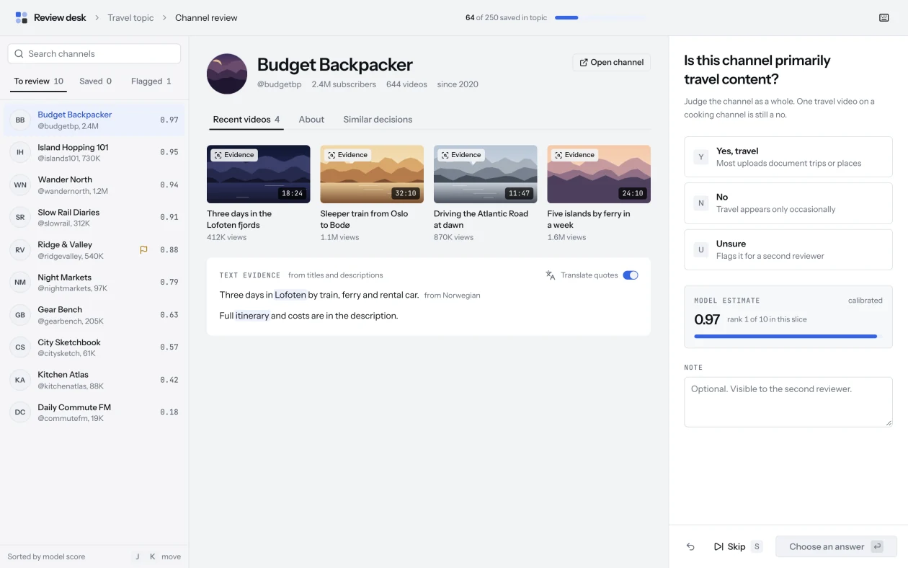

# atelier

[](https://github.com/EssenceSentry/atelier/actions/workflows/ci.yml)
[](package.json)
[](https://essencesentry.github.io/atelier/)

**Go from an idea to a working review station, monitor, lab, or report.** Atelier gives a new tool its first useful screen, a coherent visual system, and checks for the details that tend to break as an interface grows.

**[Explore the gallery →](https://essencesentry.github.io/atelier/)** · [Compare starter and finished apps](https://essencesentry.github.io/atelier/?s=examples) · [Generate a project](#start-a-project)

- **Begin with the task.** Choose a review station, monitor, lab, or report, then replace the example data with your own.
- **Change the visual direction coherently.** Instrument, Editorial, and Console each carry their tokens through screens, components, and charts.
- **Keep the kit useful after day one.** Generated projects include local hooks, GitHub Actions, responsive checks, and an update path through Copier.



Aside’s transcript editor and Probability Lab show how the same kit becomes two different applications. [Browse the examples](https://essencesentry.github.io/atelier/?s=examples), or run `npm ci` and `npm run gallery` to explore locally.

## Start a project

```bash
uvx copier copy --trust https://github.com/EssenceSentry/atelier.git my-tool
```

`--trust` lets the template run its setup: `git init`, `npm install` (which
installs the git hooks) and `npx playwright install chromium`.

| Question | Choices |
|---|---|
| Kind | Monitor, review station, lab or report; picks the starting screen |
| Theme | Instrument (default), Editorial or Console |
| Artifact | Also build a single page for claude.ai artifacts (default yes) |
| Visibility | Private (default) or public |
| Pages | Publish the app to GitHub Pages (default for public) |

Pull later improvements into a project with `uvx copier update --trust`.

## What a project gets

- The kind's screen, every block and shadcn/ui component in the kit, and
  example data to replace. `copier update` brings later block changes; more
  shadcn components come from `npx shadcn add`.
- The theme, with the direction set in `app.config.json`.
- A placeholder app icon to replace, in the app bar and as the favicon.
- **Commit hooks** (lefthook):
  - Biome lint and format;
  - strict TypeScript;
  - a check that colours come from theme tokens;
  - zizmor on the workflows;
  - rejection of AI co-author trailers.
- **Push hooks**:
  - a build;
  - screenshots in light and dark at desktop, laptop and phone widths,
    failing on a broken chart, a console error, a spilling panel, a
    sideways scroll or colliding chart labels;
  - the artifact check, when the artifact build is on.
- **CI**:
  - runs the same hooks and keeps the screenshots;
  - audits runtime dependencies weekly;
  - pins every action by commit hash, with minimal permissions.
- **Dependabot**: weekly updates for npm and Actions, skipping versions
  younger than a week.
- **Docs**: a README with badges, `AGENTS.md` (and `CLAUDE.md` pointing to
  it) and `DEVELOPMENT.md`.

Live state for monitors comes from a [lathe](https://github.com/EssenceSentry/lathe)
service project through `useLiveState`.

## Layout

| Path | What it is |
|---|---|
| [packages/theme](packages/theme) | Three visual directions as tokens, with Instrument as the default |
| [packages/kit](packages/kit) | Screens, blocks and components that projects start from |
| [apps/gallery](apps/gallery) | Every screen in every direction; the visual check |
| `template/`, `copier.yml` | The project template; its code is links into the packages |

## Stack

Static single-page apps: Vite, React, TypeScript, Tailwind v4, shadcn/ui on
Base UI, Observable Plot for charts, Biome for lint and format, lefthook for
git hooks, Playwright for screenshot checks.

## Work on atelier

```bash
npm install
npm run gallery                       # every screen, direction and mode
npm run try-template -- --kind review --theme editorial
```

`try-template` generates a project, commits it through its own hooks and runs
its push gates. CI runs it for every kind, and also lints, type-checks and
screenshots the gallery.
