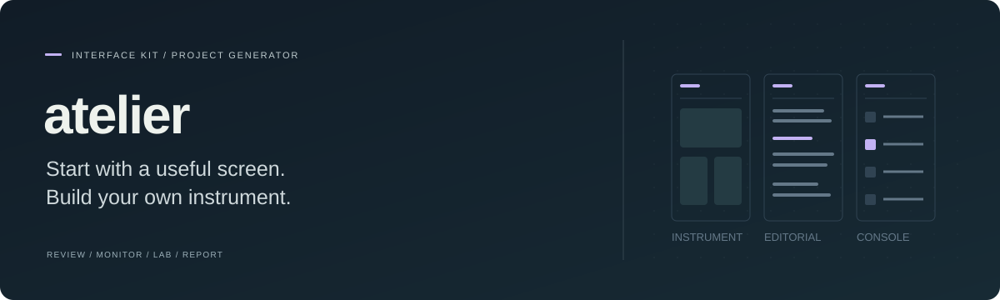

# Atelier

[](https://github.com/EssenceSentry/atelier/actions/workflows/ci.yml)

**Start your next internal tool with a screen you can already use.** A reviewer can move through a queue and inspect the evidence. An analyst can select observations in a plot and export them. Atelier gives you those interactions, their phone layouts, and the checks that keep them working as you replace the sample data with your own.

**[See two starters become applications](https://essencesentry.github.io/atelier/?s=examples)** · [Explore the gallery](https://essencesentry.github.io/atelier/) · [Generate a project](#generate-a-project)

Aside turns the review station's queue and evidence pane into a transcript editor. Probability Lab uses the analysis layout to follow a single posterior draw through a model. The examples show how each app adapts the shared layout to a different workflow.


## Pick the screen that fits the work

| Start with | When the person using it needs to… |
|---|---|
| **Review station** | Work through a queue, inspect the selected item, and record a decision with the evidence in view. |
| **Monitor** | See which job needs attention and open its log. Connect the monitor to a service with [server-sent events](packages/kit/src/lib/live.ts). |
| **Lab** | Change a parameter, select observations across linked charts, and export the matching rows. |
| **Report** | Read a finding alongside its figure, supporting measurements, and interpretation. |

Each screen comes in three visual directions. **Instrument** uses compact labels and cool surfaces for close comparison. **Editorial** pairs paper tones with serif headings for sustained reading. **Console** uses luminous marks and monospaced figures for monitoring. Switch directions in the gallery to compare the same screen in light and dark.

## Generate a project

With `uvx`, Node.js 24, and npm available:

```sh
uvx copier copy --trust https://github.com/EssenceSentry/atelier.git my-tool
cd my-tool
npm run dev
```

Choose a screen and theme at the prompts. The generator also asks about single-page artifact builds, repository visibility, and GitHub Pages. The `--trust` flag allows the template to initialize Git, install dependencies and hooks, and set up Playwright's Chromium browser.

Replace the data in `src/lib/sample.ts` and the starter icon. The generated project includes the reusable blocks, shadcn/ui components, and chart styles. Later, run `uvx copier update --trust` from the generated project to bring in template updates.

## What the checks exercise

- Commit hooks check formatting, types, theme colors, workflow security, and commit attribution.
- Push checks build the app and take light and dark screenshots at desktop, laptop, and phone widths. They flag broken charts, clipped labels, panel overflow, and horizontal page scrolling. Artifact builds have a separate check.
- CI runs the checks and saves the screenshots. Generated projects also include Dependabot configuration and a weekly runtime-dependency audit.

## Explore the kit locally

```sh
npm ci
npm run gallery
```

Open the address Vite prints to switch screens and themes. To exercise a full generation locally, run `npm run try-template -- --kind review --theme editorial`. It creates a sample project and runs its own commit and push checks.

| Source | What you'll find |
|---|---|
| [Screen and component kit](packages/kit) | React and TypeScript screens, reusable blocks, Base UI controls, and Observable Plot figures |
| [Themes](packages/theme) | Shared typography, chart palettes, and layout tokens |
| [Gallery](apps/gallery) | Screen previews and browser checks |
| [Project template](template/) | The files and [Copier prompts](copier.yml) used by generated projects |

### Component studies and portable notebooks

The [live notebook](https://essencesentry.github.io/atelier/playground.html?view=notebook) brings twenty component studies onto one page. Jump to linked plots, run a SQL query in the browser, or try the image-review tools. To explore locally, open `/gallery.html` on the gallery server or run `npm run playground`. [Playground guide](apps/gallery/README.md#integration-playground)

For a one-off HTML notebook, the experimental prebuilt distribution packages native-library adapters and sample recipes into a portable page. Authors work in plain JavaScript with the prebuilt assets. [Artifact recipes and packager](packages/artifacts/README.md) · [Authoring skill](skills/atelier-artifacts/SKILL.md)
